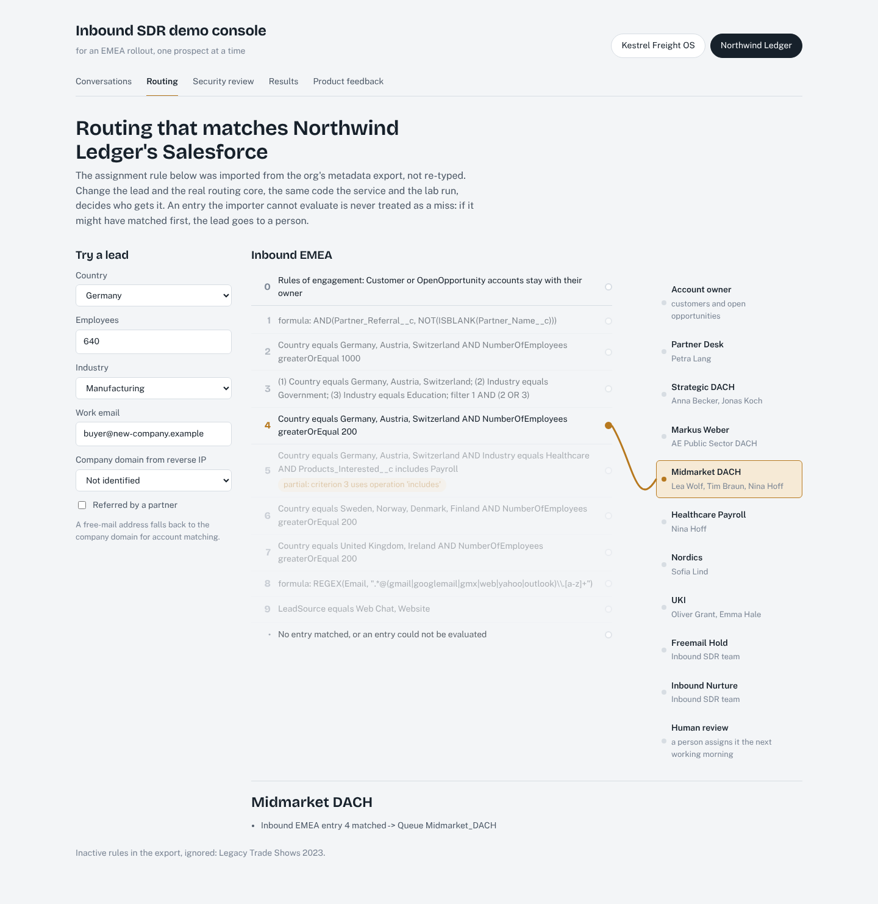
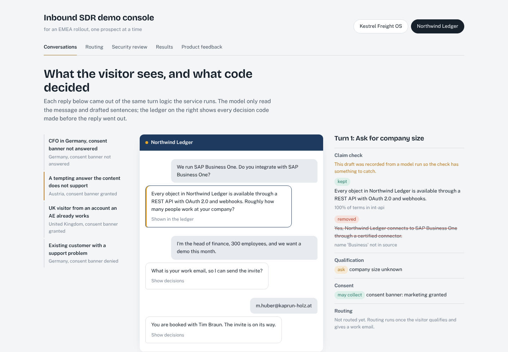
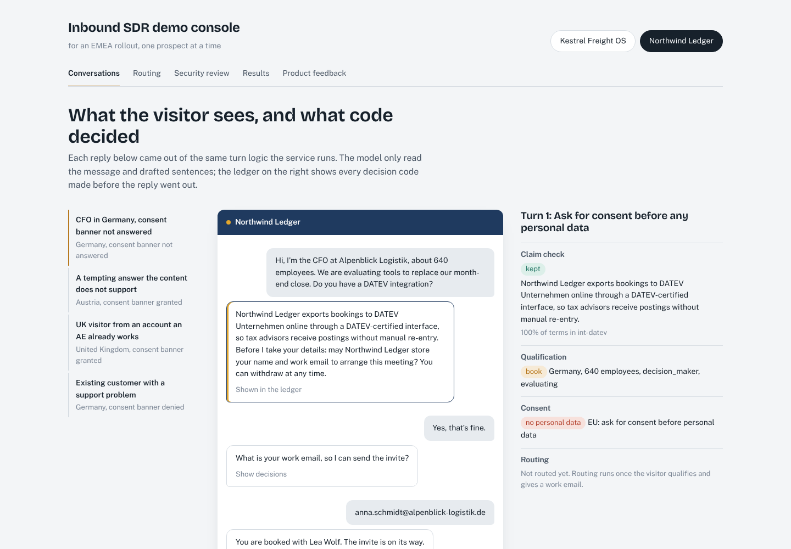
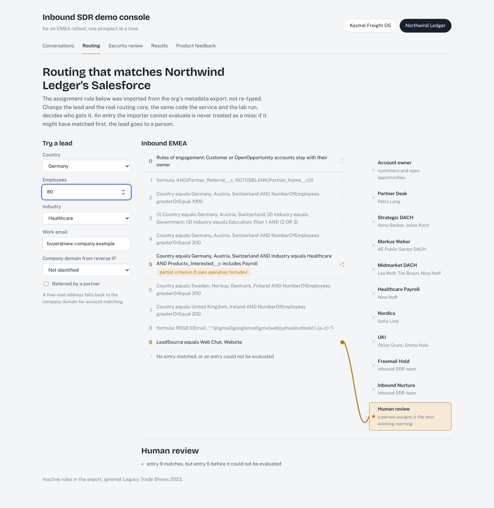
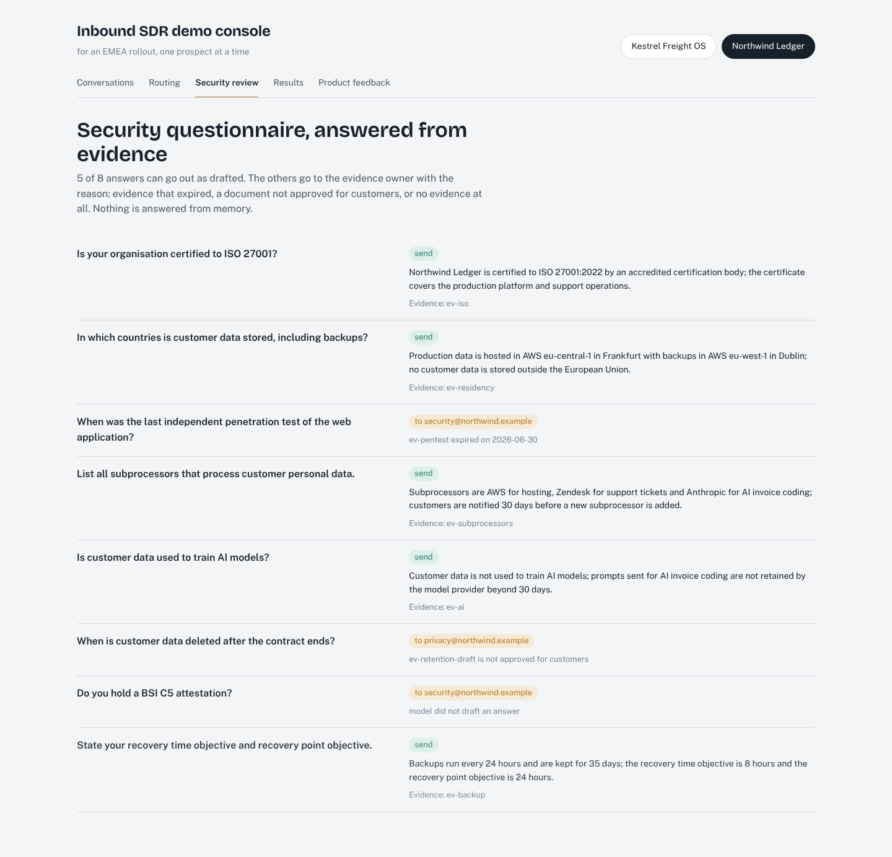

# inbound-sdr-demo-lab

**An AI SDR rollout kit for B2B websites in Europe.** It answers visitors only from approved content, asks for consent
before any personal data, books meetings with the rep the customer's own Salesforce would choose, answers security
questionnaires from in-date evidence, and writes the result back to Salesforce through Apex. A lab measures each
safeguard against the alternatives on the same simulated visitors.

It is built around what a Solutions Engineer does before an inbound AI SDR such as Qualified's Piper goes live at an
EMEA customer:

1. **Prove routing matches their Salesforce.** The core imports the org's `Lead.assignmentRules` metadata export.
   It evaluates it with Salesforce's semantics, and replays past leads against an independent reference.
2. **Answer the EMEA questions.** These are GDPR consent before personal data, EU hosting, the DPA and subprocessors,
   and the security questionnaire every enterprise deal brings.
3. **Demo per prospect in minutes.** One command builds a prospect-specific kit. The kit holds scripted conversations
   through the real turn logic, the imported routing plan, and the prospect's questionnaire.



## Results

<!-- results:start -->
Dev seeds 101, 102, 103: 18,000 engaged website sessions per design, the same visitors and the same luck for every design.

| | | |
|---|---|---|
| **4.1×**<br>Qualified meetings vs contact form<br><sub>14.4 → 59.5 per 1,000 engaged sessions</sub> | **151 → 6.2**<br>Unsupported claims vs model alone<br><sub>per 1,000 answers shown to visitors</sub> | **98.1%**<br>Routing matches Salesforce<br><sub>hand-typed rules: 69.2%</sub> |
| **0**<br>Consent violations<br><sub>model alone: 54.6 per 1,000 opt-in sessions</sub> | **−53%**<br>SE time on questionnaires<br><sub>0.9 wrong answers per 100 (model alone 25.9)</sub> | **81% → 42%**<br>Ready buyers missed<br><sub>fit buyers ready to talk who left without a meeting</sub> |

### Conversations

| Design | Qualified meetings / 1k | Pipeline / 1k sessions | Junk meetings | Wrong owner | Unsupported claims / 1k answers | Consent violations / 1k | First response | Ready buyers missed |
|---|--:|--:|--:|--:|--:|--:|--:|--:|
| Contact form, SDR calls back (today) | 14.4 | €126k | 13.1% | 0.0% | 0 | 0 | 6.5 h | 81% |
| Decision-tree chatbot, rules re-typed by hand | 55.8 | €538k | 69.4% | 62.5% | 0 | 119.6 | instant | 54% |
| LLM agent deciding on its own | 61.4 | €587k | 26.1% | 21.6% | 151 | 54.6 | instant | 45% |
| Model reads, code decides | 59.5 | €564k | 3.5% | 4.0% | 6.2 | 0 | instant | 42% |

<details><summary>Ablations: the platform with one safeguard removed</summary>

| Design | Qualified meetings / 1k | Pipeline / 1k sessions | Junk meetings | Wrong owner | Unsupported claims / 1k answers | Consent violations / 1k | First response | Ready buyers missed |
|---|--:|--:|--:|--:|--:|--:|--:|--:|
| Model reads, code decides | 59.5 | €564k | 3.5% | 4.0% | 6.2 | 0 | instant | 42% |
| Platform with rules re-typed by hand | 59.6 | €565k | 3.5% | 18.5% | 6.2 | 0 | instant | 42% |
| Platform without the claim check | 61.8 | €588k | 3.4% | 3.9% | 151 | 0 | instant | 41% |
| Platform without the consent gate | 68.2 | €651k | 4.0% | 3.8% | 6.2 | 51.6 | instant | 38% |
| Platform without company enrichment | 57 | €541k | 3.8% | 9.7% | 6.2 | 0 | instant | 44% |
| Platform ignoring account ownership | 59.5 | €564k | 3.5% | 16.8% | 6.2 | 0 | instant | 42% |

</details>

### Routing parity: 12 months of leads replayed against Salesforce

| Routing source | Leads replayed | Same owner as Salesforce | Sent to review | Largest mismatch |
|---|--:|--:|--:|---|
| Imported from the Salesforce metadata export | 7,500 | 98.1% | 1.6% | free-mail address, so the owning account cannot be matched (138) |
| Re-typed by hand into a chat tool | 7,500 | 69.2% | 0.0% | account owner ignored (1012) |

Import of `Lead.assignmentRules`: 9 entries in the active rule, 0 refused, 1 partly evaluable (entry 5: criterion 3 uses operation 'includes').

### Security questionnaires

| Security questionnaire | Wrong answers / 100 | Sent without SE edit | Sent to evidence owner | SE time / 100 questions |
|---|--:|--:|--:|--:|
| SE answers by hand | 1.3 | 0% | 28% | 10.0 h |
| Model answers alone | 25.9 | 88% | 12% | 1.2 h |
| Model drafts, evidence gate decides | 0.9 | 63% | 37% | 4.8 h |

### Gates

| Gate | Dev seeds | Held-out seeds |
|---|---|---|
| Qualified meetings at least 3x the contact form | pass (59.500 >= 43.200) | pass (60.300 >= 47.400) |
| Under 8% of booked meetings are with visitors outside the ICP | pass (0.035 <= 0.080) | pass (0.036 <= 0.080) |
| Under 6% of meetings land with the wrong owner | pass (0.040 <= 0.060) | pass (0.025 <= 0.060) |
| At most 10 unsupported claims per 1,000 answers | pass (6.200 <= 10) | pass (6 <= 10) |
| Unsupported claims at most a tenth of the model acting alone | pass (6.200 <= 15.100) | pass (6 <= 15.660) |
| No personal data taken without consent in opt-in countries | pass (0 == 0) | pass (0 == 0) |
| First response within a minute | pass (0 <= 1) | pass (0 <= 1) |
| Imported routing matches Salesforce on at least 97% of auto-routed leads | pass (0.981 >= 0.970) | pass (0.978 >= 0.970) |
| Imported routing beats hand-typed rules by 20 points | pass (0.981 >= 0.892) | pass (0.978 >= 0.888) |
| At most 3% of leads sent to human review | pass (0.016 <= 0.030) | pass (0.014 <= 0.030) |
| At most 2.5 wrong security answers per 100 questions | pass (0.900 <= 2.500) | pass (0.600 <= 2.500) |
| SE time on questionnaires at most 60% of answering by hand | pass (285 <= 360) | pass (292 <= 360) |

Held-out seeds 9101, 9102 (12,000 sessions per design) were run once, after the gates were frozen; see `reports/heldout.lock`.

| Design | Qualified meetings / 1k | Pipeline / 1k sessions | Junk meetings | Wrong owner | Unsupported claims / 1k answers | Consent violations / 1k | First response | Ready buyers missed |
|---|--:|--:|--:|--:|--:|--:|--:|--:|
| Contact form, SDR calls back (today) | 15.8 | €138k | 7.8% | 0.0% | 0 | 0 | 6.8 h | 80% |
| Decision-tree chatbot, rules re-typed by hand | 56.7 | €534k | 69.7% | 61.7% | 0 | 115.9 | instant | 55% |
| LLM agent deciding on its own | 62.2 | €587k | 27.5% | 23.8% | 156.6 | 53.2 | instant | 45% |
| Model reads, code decides | 60.3 | €568k | 3.6% | 2.5% | 6 | 0 | instant | 47% |
<!-- results:end -->

The full tables are in [REPORT.md](REPORT.md).

## What you see in the console

| | |
|---|---|
|  |  |
| **Conversations.** Each reply is next to the ledger of what code decided: the sentences kept or removed by the claim check, qualification, consent and routing. | **Consent.** The banner was not answered, so the agent asks in chat before the email. A "no" is final. |
|  |  |
| **Refuse, don't guess.** Entry 5 needs a multi-select field that a chat lead does not have, so this lead goes to a person with the reason. | **Security review.** An expired pen-test summary and an unapproved retention draft go to their owners instead of into the answer. |

[Results view](docs/screenshots/results.png) · [Product feedback](docs/screenshots/product-feedback.png) ·
[Second prospect, Kestrel](docs/screenshots/kestrel-conversation.png) · [Mobile](docs/screenshots/conversation-mobile.png)

## How it decides

```
visitor message ──► retrieval over approved content (BM25) ──► model reads: facts + cited draft sentences
                                                                   │
            ┌──────────────────────────────────────────────────────┘
            ▼
   claim check ──► consent gate ──► qualification (playbook ICP) ──► router
   (numbers, names,   (banner or in-chat     (ask what is missing,      (rules of engagement, then the imported
    absolute words    consent before any     nurture, support, book)     Salesforce rule; unknown → human review)
    must be in the    personal data)                                              │
    cited passage)                                                                 ▼
                                                                 Apex REST write-back: upsert Lead on Conversation_Id__c,
                                                                 or log on the existing Contact
```

The model reads, and code decides ([ADR 0001](docs/adr/0001-model-reads-code-decides.md)). The model never routes,
qualifies or decides consent. Claude is used when `ANTHROPIC_API_KEY` is set. Otherwise a deterministic keyword reader
runs, which is what the demo kits and tests use.

## How the lab works

- **A world with hidden truth.** Each engaged session has a company, a role, a buying stage, consent-banner state,
  questions, and the owner Salesforce would really assign. The world computes that owner with its own reimplementation
  of the assignment-rule semantics, and it never imports the core.
- **Same luck for every design.** Every random draw is keyed by seed, session and purpose. Each design meets the same
  visitors, the same reactions and the same model errors.
- **Designs.** The contact form with an SDR callback (today), a decision-tree chatbot with hand-typed routing, an LLM
  agent deciding alone, and the platform. Five ablations each remove one safeguard: imported rules, the claim check,
  the consent gate, enrichment, account matching.
- **Held-out seeds.** Twelve gates were frozen, then two held-out seeds ran once. `reports/heldout.lock` records when,
  and the CLI refuses a second run.

## Run it

```bash
npm ci && (cd web && npm ci)
npm test                      # 60 tests
npm run lab:check             # dev results reproduce, gates pass
npm run demo                  # rebuild the per-prospect demo kits
npm run serve                 # API on :8787 (keyword reader, or Claude with ANTHROPIC_API_KEY)
cd web && npm run dev         # console on :5173
```

API (the tenant comes from the API key, `SDR_API_KEYS=northwind:<key>,kestrel:<key>`):

| Method | Path | Does |
|---|---|---|
| POST | `/v1/conversations` | start a conversation with country, consent-banner state, reverse-IP domain |
| POST | `/v1/conversations/:id/messages` | one turn; `messageId` makes retries return the stored decision |
| POST | `/v1/routing/import` | import an `AssignmentRules` export and report refused or partial entries |
| POST | `/v1/routing/replay` | route up to 5,000 leads with the imported rule |
| POST | `/v1/questionnaires` | answer security questions from the evidence library, or route them to the owner |

Salesforce write-back: deploy `salesforce/` to an org (see [SKILLS.md](SKILLS.md)), then set `SF_INSTANCE_URL` and
`SF_ACCESS_TOKEN`. The Apex is linted by PMD in CI. Its tests run only in an org.

## Limits

- **The numbers are from a simulation, not a customer.** Visitor behaviour, consent rates, model error rates and
  enrichment match rates are assumptions in `config/lab/world.json`. The comparisons between designs are the point. The
  absolute levels are not forecasts.
- **The model in the lab is simulated.** It drafts from a truth catalogue of correct and tempting wrong answers at set
  rates. Retrieval, the claim check, the consent gate, qualification and routing are the real core code. Claude runs
  only in the live service.
- **The claim check is lexical.** It misses dropped negations and narrowed ranges. Two such wrong answers are kept in the
  catalogue on purpose ([ADR 0004](docs/adr/0004-claim-check.md)). All questions and content are in English; German
  visitor questions against English content are not modelled.
- **Routing parity is against an independent reimplementation, not a live org.** The formula subset covers what the
  demo orgs use, plus REGEX without Java-only features. Territory management, Omni-Channel and lead-to-account matching
  beyond domains are out of scope.
- **The Apex has not run in a real org here.** It is static-checked by PMD and has Apex tests written for a scratch org.
- **Consent rules are configuration, not legal advice.** Each customer's counsel sets the policy.
- **Not affiliated with Qualified or Salesforce.** The prospects, orgs, accounts and people are fictional.

## More

[AGENTS.md](AGENTS.md) (invariants and map) · [SKILLS.md](SKILLS.md) (repeatable tasks) · [ADRs](docs/adr) ·
[Blog post: Your AI SDR should route like your Salesforce does](docs/blog/route-like-your-salesforce.md)
